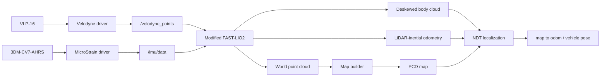

# VLP-16 + CV7 3D Mapping & NDT Localization

> 현재 개발 중인 ROS 2 기반 3D 매핑·위치추정 프로젝트입니다. 이 저장소는 2026-09-14 기준 작업 내용을 보존한 중간 스냅샷이며, 실제 차량 주행 검증 후 내용을 계속 보완할 예정입니다.


## 프로젝트 개요

Velodyne VLP-16 LiDAR와 MicroStrain 3DM-CV7-AHRS IMU를 결합해 3D 지도를 생성하고, 저장한 지도에서 차량 위치를 추정하는 시스템을 개발하고 있습니다. ROS 2 Humble 환경에서 FAST-LIO2로 LiDAR-inertial odometry를 계산하고, 직접 구현한 voxel map builder와 PCL NDT localization을 연결했습니다.

이 프로젝트의 목표는 다음과 같습니다.

- VLP-16과 CV7의 실제 출력 형식·좌표계·주기에 맞는 LIO 입력 구성
- 노트북에서 동작할 수 있는 3D 지도 누적과 PCD 저장
- 저장 지도와 현재 점군을 이용한 NDT 기반 위치 보정
- 초기 위치 오차와 일시적인 정합 실패에서도 위치 출력이 급격히 흔들리지 않는 복구 구조 설계

## 시스템 구성

| 구분 | 구성 |
|---|---|
| LiDAR | Velodyne VLP-16, 약 9.9 Hz |
| IMU | MicroStrain 3DM-CV7-AHRS, 약 100 Hz |
| 환경 | ROS 2 Humble, C++17, PCL, Eigen |
| LIO | FAST-LIO2 ROS 2 포팅본을 VLP-16/CV7 환경에 맞게 수정 |
| Mapping | voxel 기반 전역 점군 누적과 동적 잔상 제거 |
| Localization | 부분 지도 기반 PCL NDT와 단계적 재탐색 |



## 구현한 내용

### 1. VLP-16 입력에 맞춘 FAST-LIO2 수정

기준으로 사용한 FAST-LIO2 ROS 2 포팅본은 Livox 중심의 의존성과 입력 처리를 포함하고 있었습니다. VLP-16의 `x/y/z/intensity/ring/time` 필드를 직접 처리하도록 보완하고, 유효하지 않은 좌표와 ring을 제거한 뒤 point time 순서로 정렬했습니다. LiDAR는 Reliable QoS, IMU는 SensorData QoS로 수신하도록 조정했으며, timestamp가 역행하면 병렬 버퍼를 함께 초기화하도록 수정했습니다.

CV7이 뒤집힌 방향으로 장착된 시험 환경에서도 지도의 수평면과 LiDAR 전방을 일관되게 유지할 수 있도록, 초기 IMU 평균 가속도와 LiDAR 외부 회전을 이용해 world frame의 중력 방향과 heading을 초기화했습니다. 수정 사항은 [`patches/fast_lio_ros2.patch`](patches/fast_lio_ros2.patch)에 보존했습니다.

### 2. 지도 누적과 동적 잔상 제거

[`map_builder_node.cpp`](velodyne_slam/src/map_builder_node.cpp)는 FAST-LIO2가 출력한 world-frame 점군을 voxel 단위로 누적하고 PCD로 저장합니다. 현재 라이다 원점에서 측정점까지의 광선 경로를 free space로 간주하고, 기존 voxel이 여러 스캔에서 연속으로 비어 있다고 관측될 때만 삭제합니다. 점이 다시 관측되거나 중간 스캔의 대응 odometry가 없으면 누적 횟수를 초기화해 벽과 고정 물체가 쉽게 지워지지 않도록 했습니다.

### 3. 비동기 NDT 위치추정과 복구

[`ndt_localization_node.cpp`](velodyne_slam/src/ndt_localization_node.cpp)는 저장 지도 전체를 매번 정합하지 않고 예상 위치 주변의 부분 지도만 사용합니다. NDT는 별도 작업 스레드에서 실행하며 대기 점군은 최신 한 장만 유지해 ROS callback과 pose 발행이 막히지 않도록 구성했습니다.

정합 결과는 수렴 여부만 사용하지 않고 fitness, overlap, 반복 횟수, 예측 위치 대비 보정량을 함께 검사합니다. 초기 위치와 재탐색 후보는 차량 이동을 보상한 지도 보정값이 연속으로 일치할 때만 적용합니다. 추적이 끊기면 최근 위치 주변부터 재탐색하고, 실패가 계속되면 탐색 범위와 허용 조건을 단계적으로 완화합니다. 복구 후에는 더 엄격한 조건을 연속으로 통과할 때까지 한 단계씩 정상 기준으로 되돌립니다.

### 4. 좌표계와 차량 기준점 정리

Mapping에서는 FAST-LIO2가 `map → imu_link`를 발행하고, localization에서는 `odom → imu_link`를 유지하면서 NDT가 `map → odom`만 보정합니다. FAST-LIO2 내부 상태에 지도 보정을 다시 주입하지 않아 동일한 보정이 두 번 적용되는 것을 피했습니다. 사용자에게 표시하는 차량 위치는 IMU나 LiDAR 원점이 아니라 카트 뒷바퀴 축 중심인 `base_link`를 기준으로 계산합니다.

## 현재 결과


| 검증 항목 | 현재 결과 | 범위 |
|---|---:|---|
| VLP-16 point cloud | 약 9.9 Hz, 29,184 points/scan | 실제 센서 정지 측정 |
| CV7 IMU | 약 100 Hz | 실제 센서 정지 측정 |
| 합성 FAST-LIO2 출력 | 약 9.8 Hz | 작은 정지 실내 합성 입력 |
| 합성 파이프라인 메모리 | Mapping 약 214 MB, Localization 약 228 MB | 자식 프로세스 peak RSS |
| NDT 합성 정합 | overlap 1.0, 최근 기록 약 3–10 ms | 작은 부분 지도 |
| 추적 복구 | 완화된 재탐색과 엄격 조건 복귀 확인 | 합성 파이프라인 |

단위 테스트에서는 알려진 변환의 NDT 정합, 지도 밖 초기값과 빈 점군 거부, 초기 자세와 차량 기준점 변환, 위치 보정 속도 제한, 연속 free-space 판정을 확인했습니다. 원시 측정과 합성 검증 결과는 [`velodyne_slam/docs`](velodyne_slam/docs)에 저장했습니다.

## 현재 진행 상태와 제한

현재 구현은 LiDAR-inertial mapping과 저장 지도 기반 localization 단계입니다. 다음 항목은 아직 완료하지 않았습니다.

- 실제 차량 이동 상태에서 LiDAR–IMU 외부 보정과 시간 오프셋 검증
- 기준 궤적을 이용한 절대 위치 정확도 측정
- 넓은 지도와 빠른 이동에서의 연산 시간·메모리 측정
- 반복 주행에서 동적 잔상 제거 파라미터 비교
- loop closure와 pose graph optimization
- 지도 전체 범위의 global relocalization

현재 저장된 지도와 자세는 미측정 외부 보정값을 사용한 시험 결과이므로 정밀 위치 결과로 간주하지 않습니다.

## 저장소 구성

```text
3D_SLAM/
├── velodyne_slam/        # 직접 구현한 ROS 2 패키지와 현재 개발 문서
├── patches/              # FAST-LIO2에 적용한 로컬 변경
├── images/               # RViz 결과 화면
└── README.md
