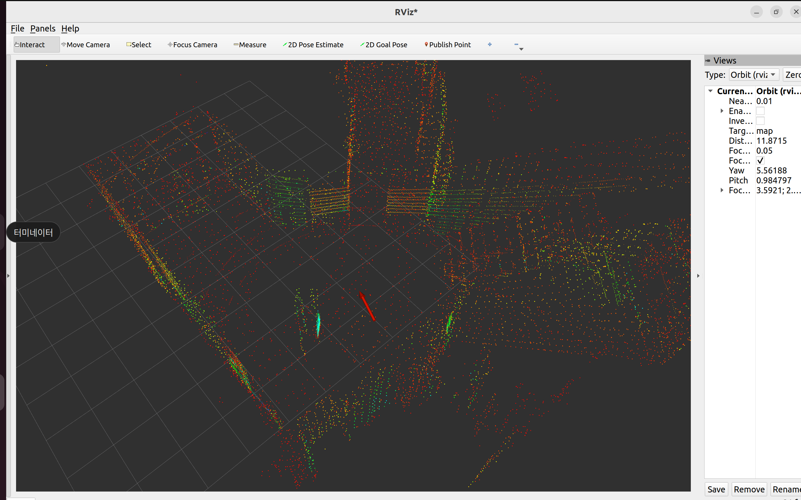
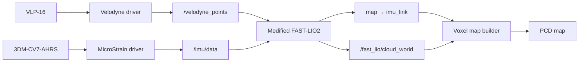
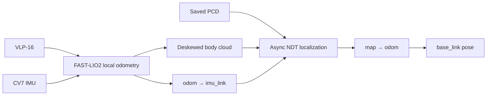
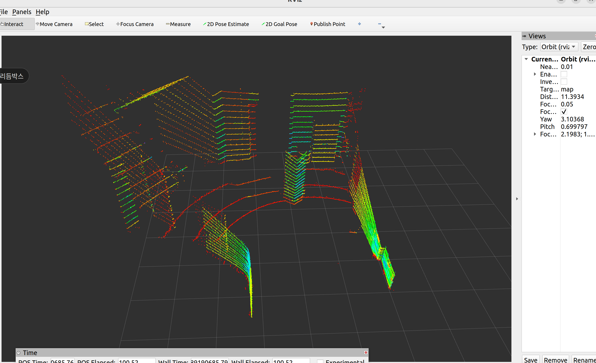

# VLP-16 + CV7 3D Mapping & NDT Localization

> ROS 2 Humble 기반의 3D mapping·localization 프로젝트입니다. 2026-09-14까지 구현한 코드 구조와 주요 처리 방식을 정리했습니다.



## 프로젝트 목표

Velodyne VLP-16 LiDAR와 MicroStrain 3DM-CV7-AHRS IMU로 3D 지도를 만들고, 저장한 PCD 지도에서 카트의 위치를 계속 추정하는 시스템을 개발했습니다. FAST-LIO2를 VLP-16 입력과 센서 장착 방향에 맞게 수정하고, voxel map builder와 PCL NDT localization을 직접 연결했습니다.

이 과정에서 다음 문제를 해결하는 데 집중했습니다.

- organized VLP-16 점군의 비유한 점과 point time을 FAST-LIO2 입력에 맞게 정리
- 뒤집혀 장착된 IMU에서도 위쪽 축과 초기 LiDAR heading이 일관된 지도 생성
- 움직이는 물체가 지도에 계속 남지 않도록 free-space 관측 기반 voxel 삭제
- NDT 계산 중에도 ROS callback과 pose 발행을 유지하는 비동기 구조
- 초기 위치 오차와 추적 단절에서 가까운 후보부터 단계적으로 넓히는 재탐색
- 큰 지도 보정이 RViz pose에 순간 적용되지 않도록 시간 기반 보정 제한

## 시스템 구성

### Mapping



### Localization



Mapping에서는 FAST-LIO2의 전역 좌표를 `map`으로 사용합니다. Localization에서는 FAST-LIO2를 연속적인 로컬 `odom`으로 두고 NDT가 `map → odom`만 보정합니다. 지도 보정을 FAST-LIO2 내부 상태에 다시 주입하지 않아 같은 보정이 중복 적용되지 않도록 했습니다.

## 주요 구현

### VLP-16/CV7에 맞춘 FAST-LIO2

VLP-16의 `x/y/z/intensity/ring/time` 필드를 직접 처리하고, NaN·Inf, 잘못된 ring과 time을 제거한 뒤 point time 순서로 정렬했습니다. LiDAR는 Reliable QoS, IMU는 SensorData QoS로 수신하고, timestamp가 역행하면 서로 대응하는 버퍼를 함께 초기화합니다.

초기 IMU 평균 가속도로 중력 방향을 정렬하면서 LiDAR 전방을 world +X로 유지하는 초기 좌표 정렬도 추가했습니다.

### Voxel 지도와 동적 잔상 제거

[`map_builder_node.cpp`](velodyne_slam/src/map_builder_node.cpp)는 world-frame 점군을 0.2 m voxel로 누적하고 PCD로 저장합니다. 현재 LiDAR 원점에서 측정점 앞까지 광선을 추적해 기존 voxel이 연속 5회 free space로 관측될 때 삭제합니다. 중간 스캔에서 광선이 지나가지 않았거나 점이 다시 관측되면 연속 횟수를 초기화해 고정 구조물이 쉽게 지워지지 않도록 했습니다.

### 비동기 NDT와 단계적 재탐색

[`ndt_localization_node.cpp`](velodyne_slam/src/ndt_localization_node.cpp)는 예상 위치 주변의 부분 지도만 구성해 NDT를 실행합니다. 정합은 별도 작업에서 처리하며 최신 점군 한 장만 대기시켜 계산 지연이 누적되지 않도록 했습니다. 수렴 여부와 함께 fitness, overlap, 반복 횟수, 예상 위치 대비 보정량을 검사합니다.

추적 단절 직후에는 strict 조건을 유지한 채 ±0.25 m·±2.5°를 찾고, 3초 뒤에는 ±0.5 m·±5°로 넓힙니다. 8초 이후에는 3초 간격으로 조건과 탐색 범위를 최대 6단계까지 완화합니다. 초기 위치와 복구 후보는 차량 이동을 보상한 결과가 3회 연속 일관될 때 채택하며, 복구 후에도 더 엄격한 조건을 단계별로 다시 통과해야 정상 추적으로 돌아갑니다.

확정된 지도 보정은 최대 0.5 m/s, 15°/s로 출력에 반영합니다. 실제 이동을 나타내는 FAST-LIO odometry는 계속 즉시 반영되며, NDT로 계산한 전역 correction만 제한합니다.

### 차량 기준 pose

사용자에게 표시하는 `/localization/pose`는 LiDAR나 IMU 원점이 아니라 카트 뒷바퀴 축 중심인 `base_link`입니다. `/localization/lidar_pose`와 `/localization/imu_pose`도 함께 발행해 센서 원점과 차량 기준점을 구분했습니다. RViz의 `2D Pose Estimate` 역시 `base_link` 위치와 카트 전방을 입력받습니다.

## 시연 영상

| 영상 | 확인할 수 있는 동작 |
|---|---|
| [초기 자세 입력과 지역 정합](videos/localization_initial_pose_refinement.webm) | RViz에서 큰 방향 변화를 포함한 초기 자세를 입력한 뒤 현재 점군과 pose가 지도 구조에 맞춰지는 과정 |
| [이동 중 pose 갱신과 재정렬](videos/localization_motion_and_realignment.webm) | 이동·회전 중 pose와 현재 점군이 계속 갱신되고, 일시적으로 벌어진 지도와의 기하 구조가 다시 가까워지는 과정 |

두 영상은 2026-09-14의 최종 파라미터 조정 이후 녹화했으며, 수동 초기 자세 입력과 이동 중 localization 동작을 RViz에서 확인할 수 있습니다.

## 예외 처리

실제 센서와 비동기 정합에서 잘못된 한 입력이 전체 pose를 오염시키지 않도록 단계마다 입력을 검사합니다.

- launch 단계에서 mode, boolean 인자, 지도 파일 존재 여부와 센서 장착 행렬을 검사합니다.
- 장착 회전행렬은 모든 값이 유한한지, 각 축이 직교하는지, determinant가 +1인지 확인합니다.
- LiDAR point의 NaN·Inf, 잘못된 ring과 음수 time을 제거하고 point time 순서를 보장합니다.
- odometry와 point cloud의 frame 및 timestamp를 확인하고, 0.03초 안에서 대응되는 입력만 함께 처리합니다.
- timestamp가 중복되거나 역행하면 해당 입력을 거부하고 관련 작업과 버퍼를 초기화합니다.
- NDT 결과는 수렴 여부, 반복 횟수, 유한한 pose, fitness, overlap과 보정량을 모두 통과해야 채택합니다.
- 초기화 이전에 시작됐거나 측정 시각보다 오래된 비동기 결과는 generation과 timestamp를 사용해 폐기합니다.
- 지도 저장 시 빈 지도를 거부하고 임시 파일 기록 후 rename하여 기존 PCD가 쓰기 도중 손상되는 것을 막습니다.



## 저장소 구성

```text
3D_SLAM/
├── velodyne_slam/   # 직접 구현한 ROS 2 package와 설정
├── images/          # mapping 결과 화면
├── videos/          # localization RViz 시연
└── README.md
```
